# ctrlSpend

[](https://github.com/BrendanLTW/ctrl_spend/actions/workflows/ci.yml)

**Know what's left to spend, every day.** ctrlSpend is a private, offline budgeting app for iOS and Android. You set one monthly budget that resets on payday, log spending in seconds, and see where it goes. There's no account and no bank login, and nothing leaves the phone except a CSV you export yourself.

Built in Flutter as a portfolio project, where architecture, tests and design fidelity matter more than feature count.

| | Home | Activity | Budgets | Insights | Week | Add |
|---|---|---|---|---|---|---|
| **Light** | 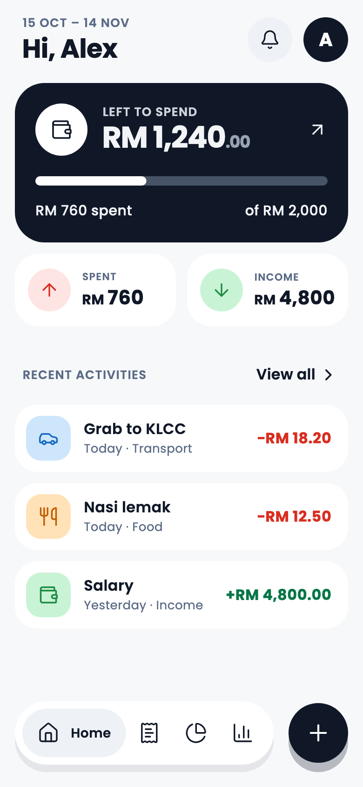 | 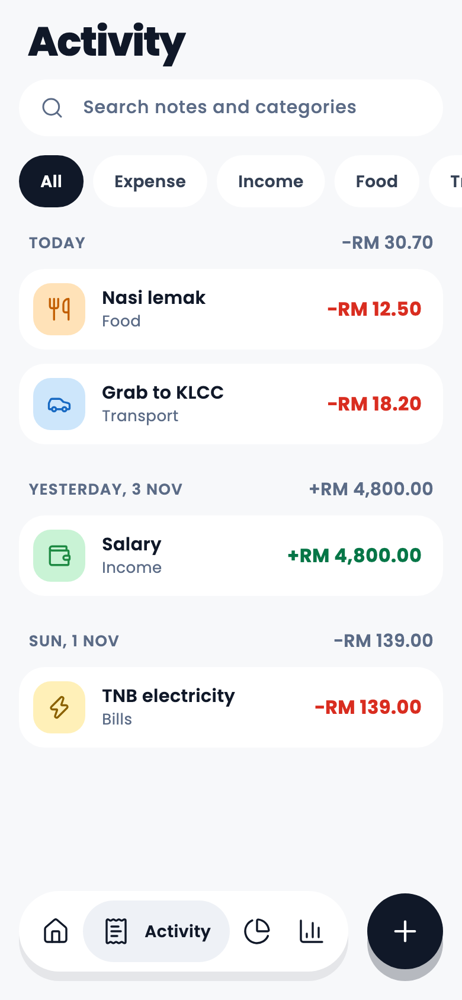 | 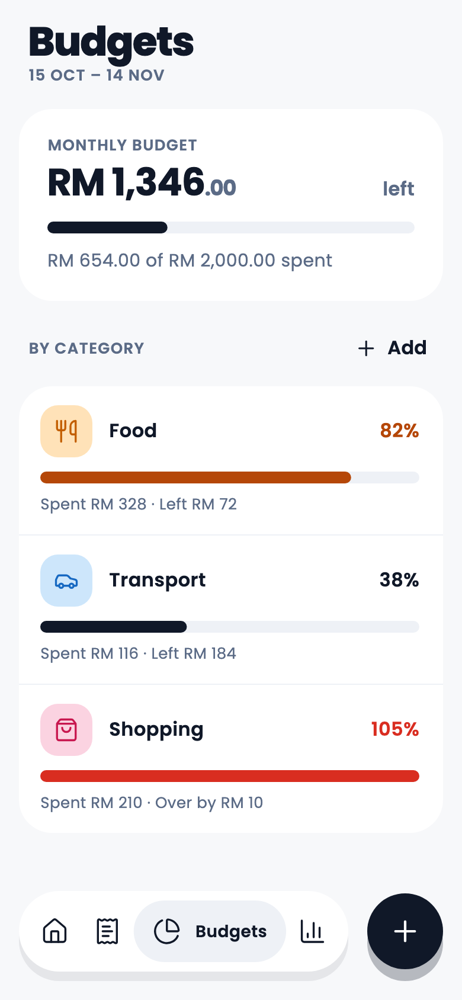 | 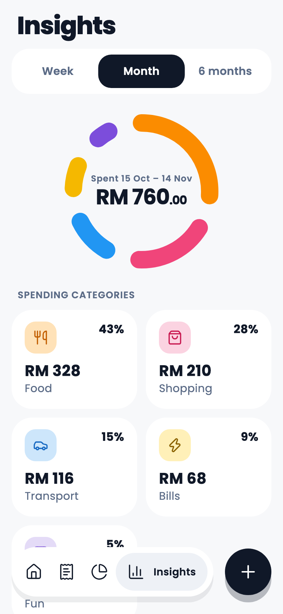 | 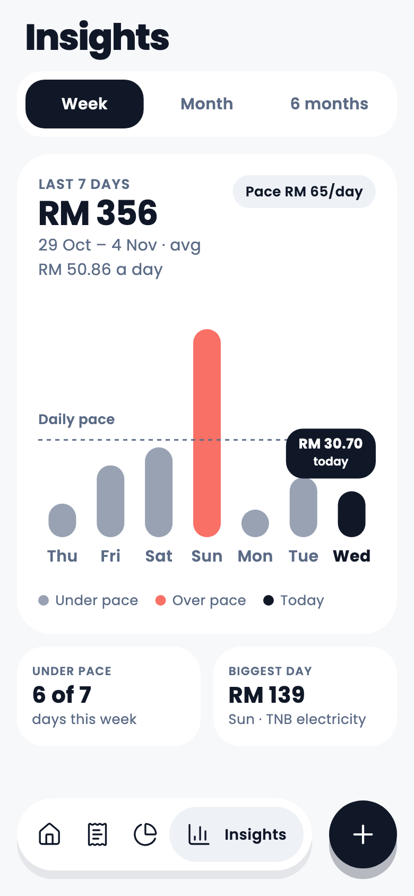 | 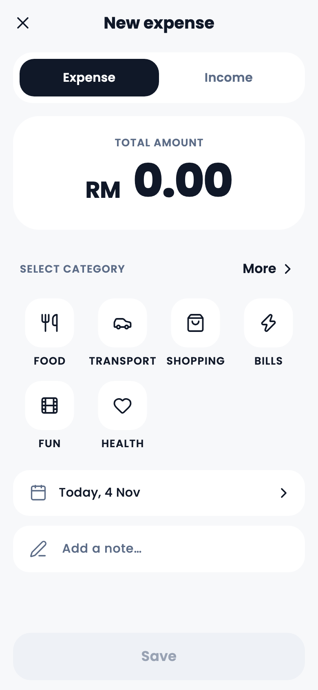 |
| **Dark** | 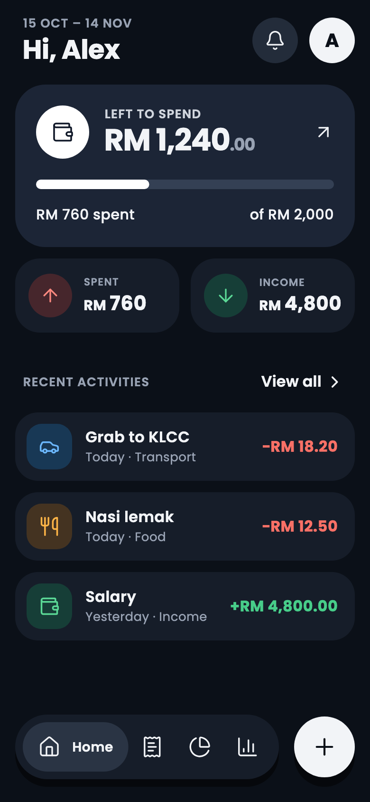 | 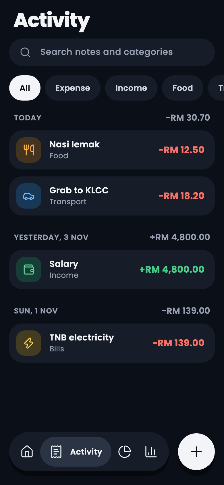 | 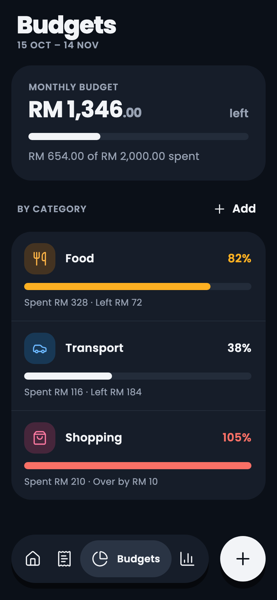 | 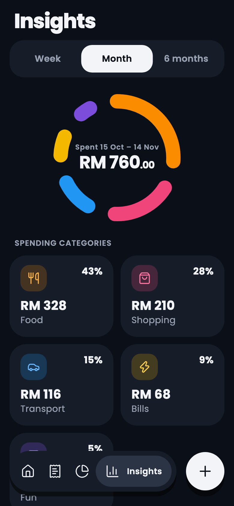 | 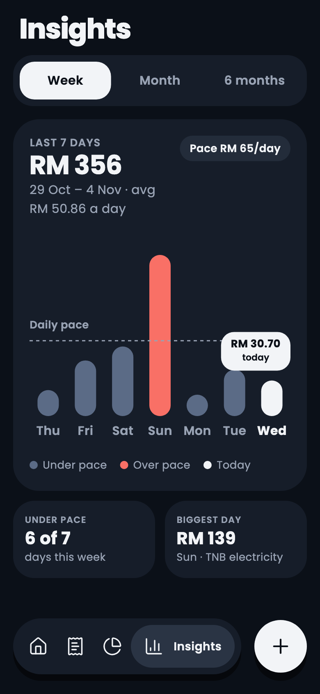 | 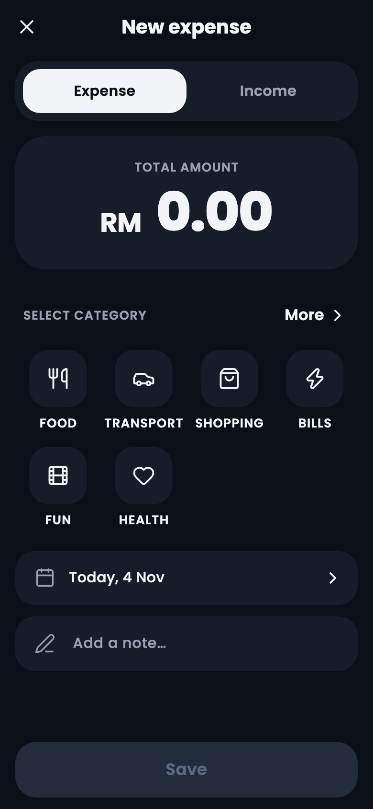 |

## Features

- **Payday periods.** A month runs from your start day (1st–28th or the last day) to the day before it next month, such as 15 Oct – 14 Nov.
- **One number first.** Home shows what's left to spend this period, and turns amber at 80% and red at 100% of the budget, always with text beside the colour.
- **Fast entry.** A keypad, a category grid and an optional title. Delete with a swipe and Undo within 5 seconds.
- **Budgets per category**, which can never add up to more than the monthly budget.
- **Insights.** The month by category, the last 7 days against a daily pace, and 6 months against the budget, with full months kept apart from the one in progress.
- **Past periods**, each with its result per category.
- **Categories.** Add your own with an icon and colour. A category with history is archived, never deleted.
- **Local notifications.** A daily reminder, budget alerts, a weekly summary and new-period notices, plus an inbox.
- **CSV export and import.** Import checks every row and saves all of them or none, listing problems by row.
- **Light, dark or system theme**, seven currencies (only the symbol changes, amounts are never converted), and Delete all data.

## Tech stack

Flutter (stable, Dart 3) · Riverpod 3 with code generation · Drift (SQLite) with versioned migrations · go_router with a `StatefulShellRoute` · freezed · intl · fl_chart · flutter_local_notifications · flutter_svg with bundled Lucide icons · very_good_analysis.

## Architecture

The code is organised feature first, and each feature has three layers. `domain/` is pure Dart: entities, repository interfaces and every calculation. `data/` implements those interfaces with Drift or a platform plugin. `presentation/` holds screens and widgets, which only see the interfaces, through Riverpod providers. `main.dart` is the one place that wires the real implementations in (`appOverrides()`), so tests swap in fakes the same way.

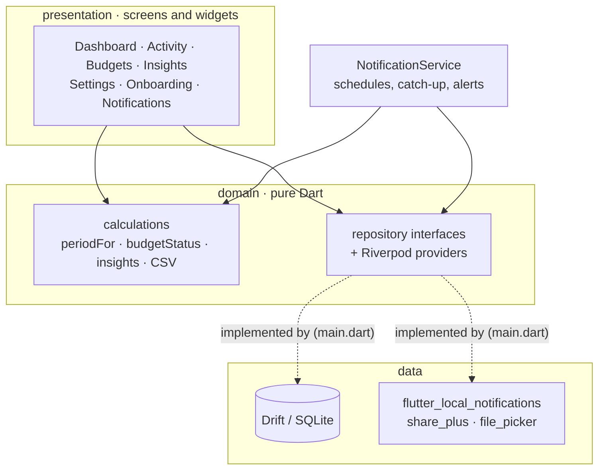

```
lib/
  core/       theme tokens, router, Drift database, periodFor, money, shared widgets
  features/   activity  budgets  categories  dashboard  data_transfer  dev
              insights  notifications  onboarding  periods  settings  transactions
                └─ data/  domain/  presentation/
  l10n/       ARB strings
```

## Key decisions

- **Money is integer minor units** (`amountMinor`), formatted only at the edge. Switching currency changes the symbol, never the amounts.
- **One period function.** Every screen gets its dates from `periodFor(date, startDay)`, which is tested across start days 1, 15, 28 and the last day, short months and leap years, a four-year sweep with no gaps, and UTC times landing on the local day.
- **One threshold rule.** `budgetStatus` (below 80%, 80–99%, 100% and over, no budget) drives the hero, budgets, categories and notifications alike.
- **History is never lost.** A category with transactions is archived instead of deleted, and keeps its history in Activity, Insights and past periods.
- **CSV import is all or nothing**: every row is checked first, then everything is saved in one database transaction. The format is in [`docs/csv-format.md`](docs/csv-format.md).
- **Notifications without a server.** The phone shows the scheduled ones. Because the app can't run code when they fire, it writes their inbox rows the next time it opens, from a stored "last checked" time.
- **Accessible by default.** Layouts switch from side by side to stacked at 150% text and above, amounts scale down rather than truncate, and the tests enforce Flutter's tap-target, label and contrast guidelines on every screen.
- **Design fidelity.** Theme tokens only (a test fails on hard-coded colours), and every screen was compared with its light and dark design. Intentional differences are in [`docs/design-notes.md`](docs/design-notes.md).

## Tests

```sh
flutter test                                    # unit, widget, accessibility and benchmark tests
flutter test integration_test/app_flow_test.dart  # end to end, on a device or simulator
```

- **Unit tests** cover every derived value, `periodFor`, the notification rules and the CSV parser. Every repository is tested on an in-memory Drift database, including a migration test from schema v1.
- **Widget tests** cover every screen in light and dark, checking the PRD's acceptance criteria.
- **Accessibility tests** run on every screen: tap targets, labels and contrast in both themes, plus a 200% text pass that fails on layout errors or a truncated amount.
- **Benchmarks** time the calculations that run over all transactions, using 5,000 sample transactions.
- **End to end:** onboarding, then add an expense, see it on the dashboard, delete it and undo.
- **CI** runs codegen, checks the generated files are committed, then runs `flutter analyze` and `flutter test` on every push.

For on-device performance, run `integration_test/performance_test.dart` in profile mode (see [`docs/quality-audit.md`](docs/quality-audit.md)).

## Running it

```sh
flutter pub get
dart run build_runner build --delete-conflicting-outputs
flutter run
```

Debug builds have **Settings → Developer → Add 5,000 sample transactions**.

## Docs

| | |
|---|---|
| [`docs/PRD.md`](docs/PRD.md) | Requirements, screens and acceptance criteria |
| [`docs/DESIGN.md`](docs/DESIGN.md) | Design tokens, components and layout rules |
| [`docs/PLAN.md`](docs/PLAN.md) | The build plan, task by task |
| [`docs/quality-audit.md`](docs/quality-audit.md) | Dark mode, accessibility and performance results |
| [`docs/design-notes.md`](docs/design-notes.md) | Intentional differences from the designs |
| [`docs/csv-format.md`](docs/csv-format.md) | The export and import format |
| [`docs/spikes.md`](docs/spikes.md) | Notification spike findings |

## Status

All v1.0 features are built. Before tagging v1.0.0:

- On-device performance numbers for a mid-range Android phone are still to be measured.

## Credits

[Poppins](https://fonts.google.com/specimen/Poppins) (SIL Open Font License) and [Lucide](https://lucide.dev) icons (ISC), both bundled and listed on the app's licence page.
